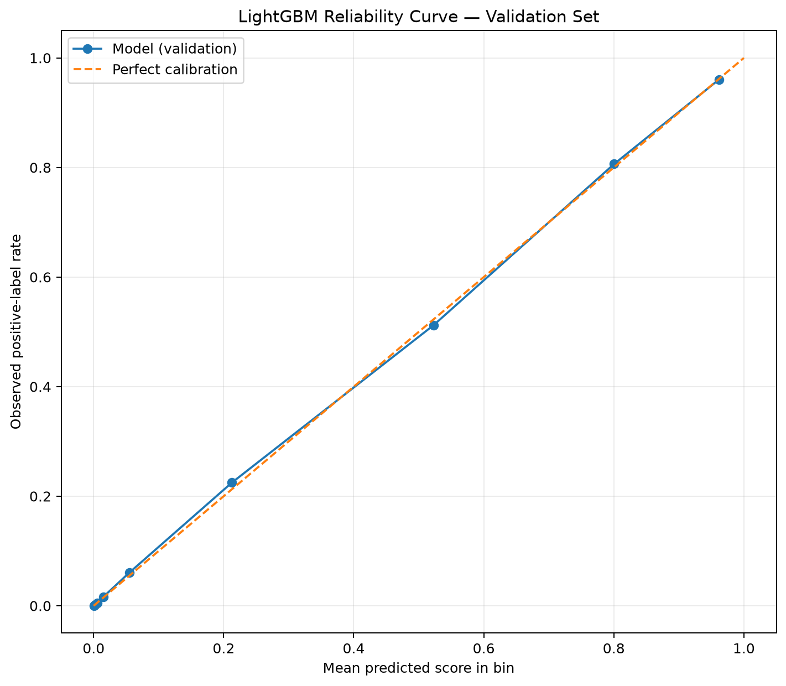
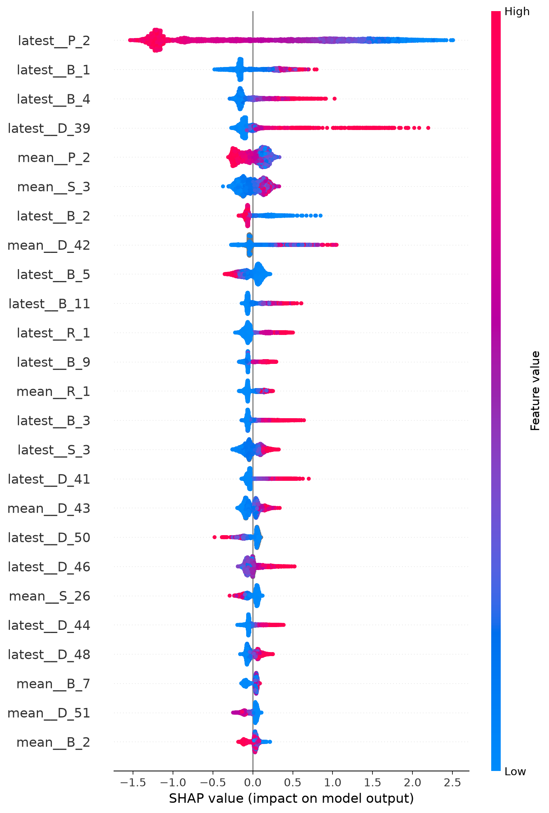
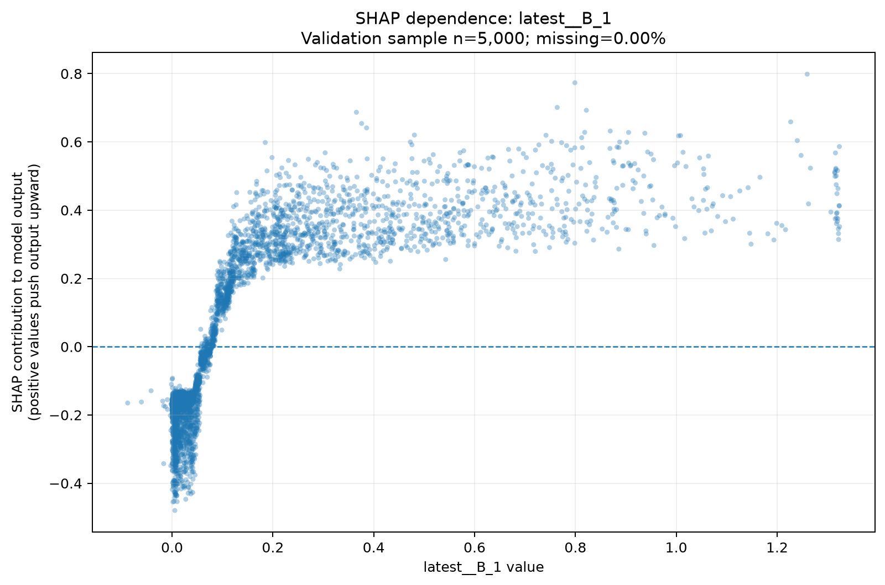
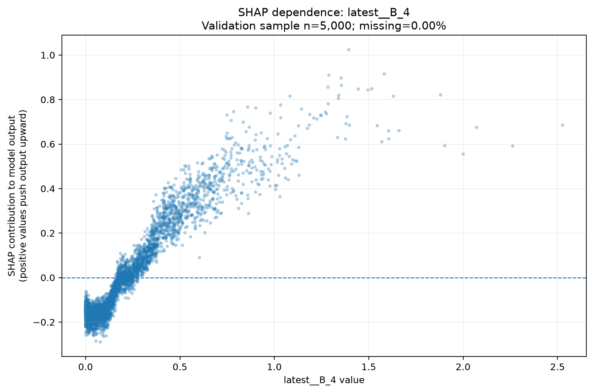
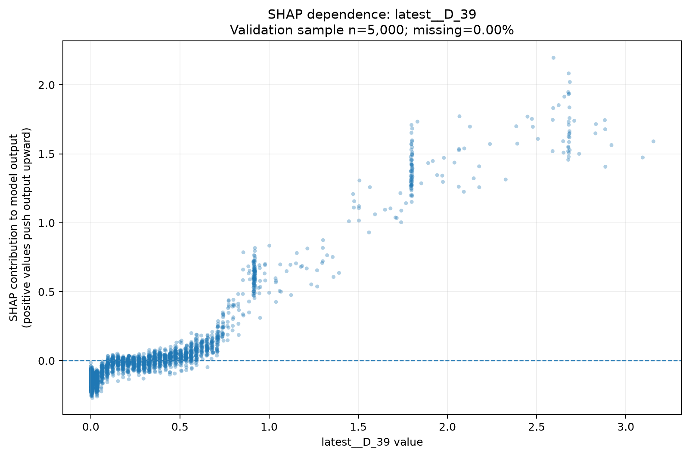
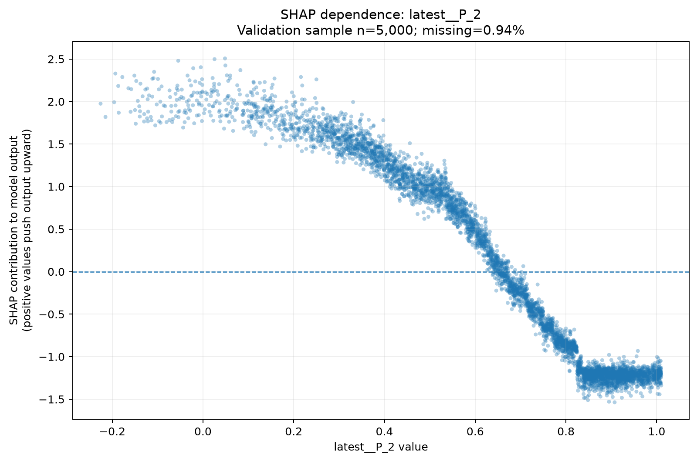

# AmEx Credit Risk Intelligence Platform

An end-to-end credit-risk analytics and machine-learning project built with the American Express Default Prediction dataset. It brings together customer-level feature engineering, data-quality and temporal audits, model benchmarking, ensemble evaluation, probability calibration, explainability, and SQL analytics.

The goal is to demonstrate how model scores can support credit-risk analysis and portfolio prioritization—not simply optimize a classification metric.

> **Evaluation note:** The metrics below describe performance on this project's held-out dataset and evaluation setup. They are not estimates of a live lender's default rate, nor a claim that the model is ready for production credit decisions.

## Results at a Glance

The selected ensemble combines **70% LightGBM + 30% CatBoost**. The weights were selected using validation data; the held-out test set was used for final evaluation.

| Metric | LightGBM Baseline | Selected Ensemble |
|---|---:|---:|
| ROC-AUC | 0.9608 | **0.9612** |
| Average Precision (AP) | 0.8970 | **0.8983** |
| Weighted Normalized Gini | 0.9216 | **0.9224** |
| Weighted Top-4% Default Capture | 65.77% | **66.22%** |
| AMEX Competition Metric | 0.7896 | **0.7923** |
| Log Loss | 0.2196 | **0.2183** |
| Brier Score | 0.0685 | **0.0681** |

**Held-out test evaluation:** 68,838 customers, including 17,825 positive examples, evaluated with 353 model features.

### Interpreting the Metrics

- **Ranking:** ROC-AUC of 0.9612 indicates strong discrimination between positive and negative examples in this held-out sample.
- **Top-4% capture:** The weighted top-4% capture result is 66.22%. Under the project's weighted metric implementation, the highest-ranked 4% captures approximately 66.22% of positive-class weight. This is a ranking/capture metric, not a statement that 66.22% of all real-world defaults can be prevented.
- **Probability quality:** Log loss and Brier score complement ranking metrics by evaluating predicted probabilities.
- **Ensemble effect:** The ensemble improves the displayed test metrics modestly over the LightGBM baseline. This is a measured result on this evaluation sample, not proof of universal superiority.

The AMEX dataset uses a sampled label distribution. Its positive-class proportion must **not** be interpreted as the natural default rate of a real credit portfolio.

## Visual Model Diagnostics

The repository includes saved plots from the project's model analysis. GitHub renders these image files directly in the README.

### 1. Probability Calibration

The reliability curve compares predicted probabilities with observed outcome frequencies across probability bins. It helps assess probability calibration; ranking quality alone does not establish that probabilities are calibrated.



Related artifacts: [Calibration metrics](reports/model_calibration/calibration_metrics.json) · [Reliability table](reports/model_calibration/reliability_table.csv) · [Calibration interpretation](reports/model_calibration/calibration_interpretation.md)

### 2. SHAP Summary

The SHAP summary plot provides a global view of feature contributions to the model's predictions. It describes model behavior and associations; it does not, by itself, establish causal effects.



Related artifacts: [SHAP feature importance](reports/model_interpretability/shap_feature_importance.csv) · [Model insights report](reports/model_interpretability/model_insights_report.md)

### 3. Feature-Dependence Analysis

The following saved plots examine selected features and their relationship to model output. They are useful for investigating patterns, but should not be interpreted as causal relationships.

| Feature | Plot |
|---|---|
| `B_1` |  |
| `B_4` |  |
| `D_39` |  |
| `P_2` |  |

### 4. Model Comparison

The results table above compares the LightGBM baseline with the selected ensemble. Additional model comparison outputs are available in [reports/model_comparison](reports/model_comparison/), including baseline metrics and ensemble evaluation files.

## Project Objectives

- Build a customer-level credit-risk modeling workflow from statement-history data.
- Audit data quality, label relationships, customer splits, and temporal coverage.
- Engineer customer-level features from monthly statements.
- Benchmark Logistic Regression, LightGBM, and CatBoost.
- Select ensemble weights using validation data.
- Evaluate ranking, top-of-list capture, and probability quality on held-out data.
- Analyze model behavior with feature importance and SHAP.
- Review calibration, robustness, and temporal characteristics.
- Provide SQL-based customer-history analytics and reusable reports.

## Dataset and Evaluation Design

The project uses the American Express Default Prediction dataset.

- The engineered customer-level feature table contains **458,913 customers** and **365 columns** in the recorded feature table.
- The selected ensemble uses **353 model features**.
- The held-out test evaluation contains **68,838 customers** and **17,825 positive examples**.
- Customer-level train/validation/test splits are created by project scripts; ensemble weights were chosen using validation results, with the test set reserved for final evaluation.

The label distribution in the competition data is sampled and does not provide a verified estimate of real-world portfolio default prevalence. Metrics and probability outputs may need recalibration for a different population or business setting.

Raw source data, engineered feature files, and trained model binaries are intentionally excluded from this public repository. Obtain the dataset from its authorized source and prepare the local artifacts required by the pipeline.

## Methodology

1. **Ingestion and staging** — inspect and load the source data and labels.
2. **Data validation** — check labels, customer relationships, data quality, and temporal coverage.
3. **Feature engineering** — create customer-level features from statement histories.
4. **Customer-level splitting** — construct train, validation, and held-out test partitions.
5. **Model benchmarking** — train Logistic Regression, LightGBM, and CatBoost baselines.
6. **Validation-based selection** — compare candidates and choose ensemble weights using validation results.
7. **Held-out evaluation** — calculate final ranking, capture, and probability-quality metrics.
8. **Model analysis** — review calibration, feature importance, SHAP explanations, robustness, and temporal behavior.
9. **Portfolio analytics** — use SQL queries to explore customer-history information.

## Architecture

```text
AMEX statement-history data and labels
                 |
                 v
       Ingestion and staging
                 |
                 v
 Data-quality / relationship / temporal audits
                 |
                 v
     Customer-level feature engineering
                 |
                 v
  Customer-level train / validation / test
                 |
                 v
 Logistic Regression | LightGBM | CatBoost
                 |
                 v
  Validation-based ensemble weight selection
                 |
                 v
       Held-out test evaluation
                 |
       +---------+----------+
       |         |          |
       v         v          v
 Calibration  SHAP and   Robustness and
 diagnostics  importance temporal audits
                 |
                 v
        Reports and SQL analytics
```

## Technology Stack

- **Language:** Python
- **Machine learning:** scikit-learn, LightGBM, CatBoost
- **Data processing:** pandas, NumPy, Parquet
- **Explainability:** SHAP
- **Analytics:** SQL
- **Testing:** pytest
- **Environment management:** Conda

`environment.yml` is the primary environment specification. `conda-linux-64.lock` is a platform-specific lock artifact for Linux.

## Repository Structure

```text
.
├── reports/
│   ├── experiments/
│   ├── explainability/
│   ├── model_calibration/
│   ├── model_comparison/
│   ├── model_interpretability/
│   │   └── dependence/
│   ├── model_robustness/
│   ├── temporal_audit/
│   ├── final_test_metrics.json
│   └── model_card.md
├── sql/
│   └── analytics/
├── src/
│   ├── explainability/
│   ├── features/
│   ├── ingestion/
│   ├── models/
│   └── validation/
├── tests/
├── .env.example
├── environment.yml
└── README.md
```

## Getting Started

### 1. Clone the Repository

```bash
git clone https://github.com/AnantVerma-58/amex-credit-risk-intelligence.git
cd amex-credit-risk-intelligence
```

### 2. Create the Conda Environment

```bash
conda env create -f environment.yml
conda activate amex
```

If the environment already exists, activate it instead:

```bash
conda activate amex
```

### 3. Run the Tests

```bash
pytest -q
```

The metric unit tests validate the custom AMEX metric implementation. Passing tests do not, by themselves, reproduce the model training or final evaluation.

### 4. Prepare Local Data and Model Artifacts

The public repository intentionally excludes the original dataset, engineered Parquet features, and trained model binaries. Pipeline and evaluation scripts that depend on those artifacts cannot run until the required local data and models have been prepared. Review the relevant scripts and reports before running individual pipeline stages.

Database-related scripts may also require local database configuration. Use `.env.example` as a template; do not commit real credentials or secrets.

## Reports and Further Analysis

- [Model card](reports/model_card.md) — model description, evaluation context, and limitations.
- [Final test metrics](reports/final_test_metrics.json) — final evaluation metrics.
- [Model comparison](reports/model_comparison/) — baseline and ensemble evaluation artifacts.
- [Calibration analysis](reports/model_calibration/) — calibration metrics, reliability curve, and interpretation.
- [Model interpretability](reports/model_interpretability/) — SHAP, feature importance, and model insights.
- [Feature-dependence plots](reports/model_interpretability/dependence/) — selected feature-level diagnostics.
- [Robustness analysis](reports/model_robustness/) — evaluation across selected groups.
- [Temporal audit](reports/temporal_audit/) — statement coverage and temporal validity analysis.
- [SQL analytics](sql/analytics/) — customer-history analytical queries.
- [Tests](tests/) — automated tests.

## Limitations and Responsible Use

- The competition dataset's sampled class distribution is not a verified real-world default rate.
- Held-out performance does not guarantee future or live-population performance.
- Ranking metrics and probability calibration measure different properties.
- SHAP and feature-importance outputs describe model behavior; they do not establish causal effects.
- Feature availability, temporal leakage, population shift, and calibration should be reassessed for any new deployment population.
- A production credit-risk system would require additional validation, monitoring, fairness assessment, governance, security controls, and compliance review.
- This repository is a portfolio analytics and machine-learning project, not a production-ready credit approval system.

## Future Improvements

- Add continuous integration for automated tests and code-quality checks.
- Document exact data preparation and end-to-end pipeline execution steps.
- Add a generated model-comparison visualization using the saved metric outputs.
- Extend risk-band and decision-threshold analysis with clearly stated business assumptions.
- Add monitoring for data drift and performance changes.
- Expand governance and fairness evaluation.

---
